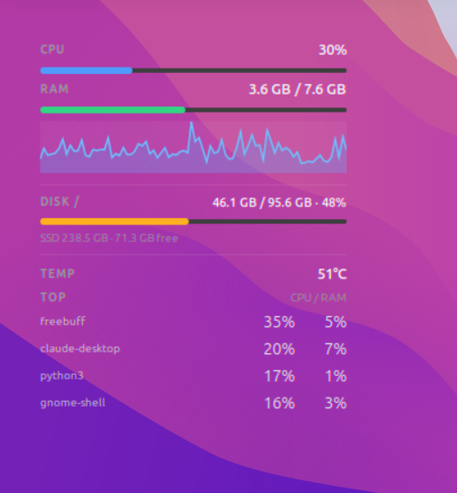

# Ubuntu Desktop Monitor

<p align="center">
  
</p>

<p align="center">
  <b>A lightweight, beautiful native GTK desktop widget monitoring live CPU, RAM, disk, thermals, and processes for Ubuntu & GNOME.</b>
</p>

<p align="center">
  
  
  
</p>

---

## ✨ Features
The monitor embeds cleanly onto your desktop wallpaper underneath your open windows rather than floating in your way, keeping system metrics visible whenever you glance at your desktop.

* **Live CPU Meter & Sparkline**: Real-time load percentage plus a rolling 5-minute visual history sparkline.
* **Memory & Swap**: Live RAM utilization with threshold colors.
* **Disk Monitoring**: Live root (`/`) and `/home` space usage plus storage device health.
* **Thermal Sensor**: Real-time CPU core temperature.
* **Top Processes**: Live top 4 resource-heavy applications ranked by CPU & RAM.
* **Smart Persistence**: Drag the widget anywhere; it automatically remembers its screen coordinates.
* **Zero Bloat**: Native Python + GTK3/Cairo. No Electron, no webviews, and no high background CPU usage.

---

## 🚀 Quick Install (Beginner-Friendly Guide)

If you are new to Ubuntu/Linux, simply open your Terminal by pressing **`Ctrl` + `Alt` + `T`**, and copy-paste these commands step by step:

### Step 1: Install System Dependencies
Install the required Python and GTK packages from Ubuntu's official repository:
```bash
sudo apt update
sudo apt install -y python3-gi python3-psutil git
```

### Step 2: Download the Project
Clone this repository to your computer:
```bash
git clone https://github.com/Pratham0981/ubuntu-desktop-monitor.git
cd ubuntu-desktop-monitor
```

### Step 3: Run the Installer
Run the user-level install script:
```bash
./install.sh
```

> 💡 **What this script does:**
> - Copies the application to `~/.local/share/dashboard-widget`
> - Creates a launcher shortcut at `~/.local/bin/dashboard-widget`
> - Configures autostart (`~/.config/autostart`) so it starts automatically on login
> - **No root/sudo required**: everything stays safely inside your home folder.

### Step 4: Start the Widget
Launch the monitor right away without needing to log out:
```bash
~/.local/bin/dashboard-widget &
```
*(From now on, it will automatically launch every time you turn on or log into your PC!)*

---

## ⚙️ Usage & Controls

### Moving the Widget
* **Click and drag** the widget anywhere on your desktop. It automatically remembers the position you chose even after a reboot.

### Always-On-Top Mode
By default, the widget stays pinned to your desktop under your open windows. If you want it floating as an always-on-top corner panel instead:
```bash
~/.local/bin/dashboard-widget --on-top &
```

---

## 🔄 How to Update
To update to the latest version at any time:
```bash
cd ubuntu-desktop-monitor
git pull
./install.sh
```

---

## 🗑️ How to Uninstall
If you ever want to completely remove the monitor, run this single command:
```bash
pkill -f 'python3 -m dashboard'
rm -f ~/.local/bin/dashboard-widget
rm -f ~/.config/autostart/dashboard-widget.desktop
rm -rf ~/.local/share/dashboard-widget
```

---

## 🧪 Running Tests (For Developers)

```bash
# Run all telemetry and data tests
pytest -q

# Run GUI window tests (using headless virtual display)
xvfb-run -a env DASHBOARD_GUI_TESTS=1 pytest -q
```
